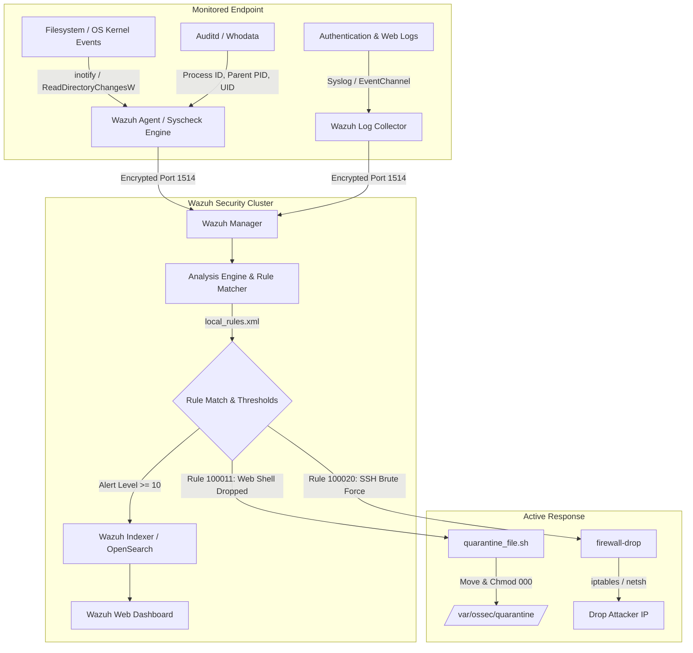

# Host-based Intrusion Detection System (HIDS) & File Integrity Monitoring (FIM) with Wazuh / OSSEC

[](https://wazuh.com/)
[](https://attack.mitre.org/)
[](LICENSE)
[](https://www.python.org/)
[](#compliance-alignment)

A production-ready security engineering project implementing **Host-based Intrusion Detection (HIDS)** and **File Integrity Monitoring (FIM)** using **Wazuh / OSSEC**, custom detection rulesets mapped to the **MITRE ATT&CK** framework, automated **Active Response** containment, Red Team attack simulation scripts, and a zero-dependency **Interactive SOC Terminal Simulator**.

---

## Table of Contents
- [Executive Overview](#executive-overview)
- [System Architecture](#system-architecture)
- [Core Capabilities](#core-capabilities)
- [Custom Detection Rules & MITRE ATT&CK Mapping](#custom-detection-rules--mitre-attck-mapping)
- [Automated Active Response & Remediation](#automated-active-response--remediation)
- [Red Team Attack Simulation Suite](#red-team-attack-simulation-suite)
- [Interactive Terminal SOC Simulator](#interactive-terminal-soc-simulator)
- [Production Lab Deployment (Docker)](#production-lab-deployment-docker)
- [SOC Analyst Triage & Playbooks](#soc-analyst-triage--playbooks)
- [Repository Structure](#repository-structure)
- [Compliance Alignment](#compliance-alignment)
- [Author & License](#author--license)

---

## Executive Overview

File Integrity Monitoring (FIM) is a foundational host security defense mechanism designed to validate the authenticity and integrity of operating system files, critical application binaries, configuration files, and registry entries. Unauthorized modification of these files is frequently the first indicator of system compromise, privilege escalation, rootkit installation, web shell backdoor placement, or ransomware encryption.

This project delivers:
1. **Hardened Wazuh Manager & Agent Configurations**: Tailored for Linux (`/etc`, `/bin`, `/var/www/html`) and Windows (`System32`, `Run`/`RunOnce` registry keys).
2. **Custom Detection Rules (XML)**: MITRE ATT&CK tagged rules capturing unauthorized user creation, web shell uploads, DNS poisoning, and canary honeypot tampering.
3. **Automated Active Response**: Automated scripts that quarantine malicious files and apply host firewall blocks upon threat detection.
4. **Adversary Simulation Suite**: Automated Python and PowerShell scripts simulating real-world Red Team attacks.
5. **Standalone Terminal SOC Simulator**: A zero-dependency Python engine that replicates Wazuh Syscheck, calculates cryptographic hashes, outputs unified diffs, and evaluates alerts in real-time without requiring a live Wazuh cluster.

---

## System Architecture



---

## Core Capabilities

### 1. Real-Time Cryptographic File Integrity Verification
- **Multi-Algorithm Hashing**: Tracks file state via `MD5`, `SHA-1`, and `SHA-256`.
- **Real-Time Kernel Inotify**: Captures file creation, modification, and deletion events instantaneously (`realtime="yes"`).
- **Unified Diff Recording (`report_changes="yes"`)**: Records exact line additions and deletions directly inside alert payloads for forensic investigation.
- **Sensitive File Masking (`<nodiff>`)**: Protects confidential credential stores (such as `/etc/shadow`) from leaking hashed passwords into log storage.

### 2. Whodata & Process Attribution
- Integrates with Linux `auditd` and Windows SACL/Sysmon.
- Records not only *what* file changed, but **who** modified it (`audit.user.name`, `audit.login_user`), **what process** made the modification (`audit.process.name`, `audit.process.id`), and the **parent process hierarchy**.

### 3. Decoy Canary Tripwires (Ransomware Early Warning)
- Deploys strategically placed decoy files (`.xlsx`, `.docx`, `.pdf`) inside monitored canary directories.
- Any unauthorized write or deletion in the canary folder triggers an immediate **Critical Level 14 alert**, alerting security teams before widespread encryption completes.

### 4. Windows Registry Integrity Monitoring
- Monitors autostart execution points in the Windows Registry:
  - `HKLM\Software\Microsoft\Windows\CurrentVersion\Run`
  - `HKLM\Software\Microsoft\Windows\CurrentVersion\RunOnce`
  - `HKLM\System\CurrentControlSet\Services`
- Detects persistence mechanisms dropped by malware or malicious installers.

---

## Custom Detection Rules & MITRE ATT&CK Mapping

Located in [`configs/manager/local_rules.xml`](configs/manager/local_rules.xml):

| Rule ID | Level | Description | Target Path / Pattern | MITRE Technique |
|:---:|:---:|---|---|:---:|
| **100010** | **10 (High)** | Critical system identity or privilege file modified | `/etc/passwd`, `/etc/shadow`, `/etc/sudoers` | [T1098](https://attack.mitre.org/techniques/T1098/) / [T1078](https://attack.mitre.org/techniques/T1078/) |
| **100011** | **12 (Critical)** | Potential Web Shell uploaded to web server root | `/var/www/html/.*\.(php\|jsp\|py\|sh\|asp)` | [T1505.003](https://attack.mitre.org/techniques/T1505/003/) / [T1105](https://attack.mitre.org/techniques/T1105/) |
| **100012** | **10 (High)** | SSH authorized_keys file modified or created | `~/.ssh/authorized_keys` | [T1098.004](https://attack.mitre.org/techniques/T1098/004/) |
| **100013** | **12 (Critical)** | System core binary modified or replaced (Rootkit) | `/bin/`, `/sbin/`, `/usr/bin/` | [T1036.005](https://attack.mitre.org/techniques/T1036/005/) / [T1565.001](https://attack.mitre.org/techniques/T1565/001/) |
| **100014** | **9 (Medium)** | Scheduled task or cron persistence modified | `/etc/cron*`, `/var/spool/cron` | [T1053.003](https://attack.mitre.org/techniques/T1053/003/) |
| **100015** | **14 (Critical)** | Decoy canary tripwire file modified or deleted | `/var/canaries/*`, `C:\canaries\*` | [T1486](https://attack.mitre.org/techniques/T1486/) (Ransomware) |
| **100016** | **13 (Critical)** | Mass file modifications detected within 30s window | Syscheck frequency threshold (>=8 events) | [T1486](https://attack.mitre.org/techniques/T1486/) / [T1485](https://attack.mitre.org/techniques/T1485/) |
| **100017** | **11 (High)** | Windows Autostart Run registry key modified | `HKLM\...\CurrentVersion\Run` | [T1547.001](https://attack.mitre.org/techniques/T1547/001/) |
| **100018** | **8 (High)** | Network routing / hosts file tampered | `/etc/hosts`, `/etc/resolv.conf` | [T1565.001](https://attack.mitre.org/techniques/T1565/001/) |
| **100020** | **10 (High)** | Repeated SSH brute force auth failures (Triggers AR) | SSH auth log aggregation (>=5 failures/60s) | [T1110.001](https://attack.mitre.org/techniques/T1110/001/) |

---

## Automated Active Response & Remediation

When high-severity rules fire, Wazuh automatically initiates defensive actions to neutralize threats:

1. **Automated File Quarantine (`active-response/quarantine_file.sh`)**:
   - Triggered by Rule **100011** (Web Shell Creation).
   - Extracts the file path from the alert JSON payload.
   - Computes SHA-256 for chain of custody.
   - Moves the file to an isolated directory (`/var/ossec/quarantine/`).
   - Strips all read, write, and execute permissions (`chmod 000`).

2. **Automated IP Blocking (`firewall-drop`)**:
   - Triggered by Rule **100020** (SSH Brute Force).
   - Appends a temporary drop rule to `iptables` / `nftables` blocking the attacker's IP for 1,800 seconds (30 minutes).

---

## Red Team Attack Simulation Suite

The `attack-simulations/` directory provides scripts to safely validate detection rules:

| Script | Attack Simulated | Expected Rule |
|---|---|:---:|
| `01_system_file_tampering.py` | Injects backdoor user into `/etc/passwd` & modifies `/etc/hosts` | Rule 100010 & 100018 |
| `02_webshell_injection.py` | Drops PHP backdoor payload into web root directory | Rule 100011 |
| `03_ransomware_canary_test.py` | Seeds canary honeypot files and simulates ransomware encryption | Rule 100015 & 100016 |
| `04_ssh_bruteforce_attack.py` | Floods SSH log with invalid password attempts | Rule 100020 |
| `05_windows_persistence.ps1` | Injects Windows Registry Run key and drops Startup batch file | Rule 100017 |
| `run_all_simulations.py` | Orchestrates all attack scenarios end-to-end | All Rules |

### Running Attack Simulations:
```bash
python attack-simulations/run_all_simulations.py
```

---

## Interactive Terminal SOC Simulator

To allow testing and demonstration **without requiring Docker or heavy multi-gigabyte Wazuh services**, this project includes a self-contained, zero-dependency Python FIM engine in `simulator/`.

### Features of the Simulator:
- Cryptographic hashing (MD5, SHA-1, SHA-256)
- Unified textual diff computation (`report_changes="yes"`)
- Full evaluation of `local_rules.xml`
- Colorized SOC terminal dashboard displaying alert levels, MITRE ATT&CK tags, and diffs
- Exports standard Wazuh-compatible `alerts.json`

### Run Automated Demo (1 Command):
```bash
# On Windows
run_demo.bat
# Or using Python directly:
python simulator/run_simulator.py --demo

# On Linux / macOS
./run_demo.sh
# Or:
python3 simulator/run_simulator.py --demo
```

### Live Directory Watch Mode:
You can also point the engine at any directory on your computer to monitor file changes live:
```bash
python simulator/run_simulator.py --watch /path/to/monitor
```

### Sample Simulator Output:
```text
================================================================================
          WAZUH / OSSEC HOST-BASED INTRUSION DETECTION & FIM LAB
                     Security Operations Console (SOC)
================================================================================

[*] Initializing Wazuh HIDS & FIM Simulation Environment...
[*] Indexing baseline cryptographic hashes across monitored directories...
[+] Baseline established: 4 files indexed into Syscheck database.

>>> SIMULATING RED TEAM ATTACK SCENARIOS <<<

[Attack 1] Adversary injects rogue UID 0 backdoor account into passwd...

 HIGH (Lvl 10)  [Rule 100010] FIM Alert: Critical system identity or privilege file modified
  Timestamp: 2026-11-04T17:00:39.115Z  |  Agent: ubuntu-lab-endpoint (192.168.10.50)
  MITRE ATT&CK: T1098, T1078
  Action: FILE_MODIFIED  -->  .../critical_configs/passwd
  SHA256 (Before): a43421811b344a1c8073edb27436f7499aed30fc64b2efac9460b00d4384c4f9
  SHA256 (After):  ac1cbcf32b52b149408bfa01c76de8c2c461885706eb81449a84a77dd35f69af

  Content Integrity Diff (report_changes=yes):
  ------------------------------------------------------------
  --- a/passwd
  +++ b/passwd
  @@ -2,3 +2,4 @@
   daemon:x:1:1:daemon:/usr/sbin:/usr/sbin/nologin
   sysadmin:x:1000:1000:SysAdmin,,,:/home/sysadmin:/bin/bash
   www-data:x:33:33:www-data:/var/www:/usr/sbin/nologin
  +backdoor_admin:x:0:0:Root Backdoor:/root:/bin/bash
  ------------------------------------------------------------
```

---

## Production Lab Deployment (Docker)

To deploy the full enterprise Wazuh SIEM stack (Wazuh Manager, OpenSearch Indexer, and Dashboard):

### 1. Prerequisites
- Docker & Docker Compose
- Minimum 4 GB RAM allocated to Docker

### 2. Launch Stack
```bash
cd deployment
docker compose up -d
```

### 3. Access Web Dashboard
- **URL**: `https://localhost:443`
- **Username**: `admin`
- **Password**: `admin`

---

## SOC Analyst Triage & Playbooks

This project provides comprehensive documentation for Security Operations Center (SOC) personnel:

- **[`FIM_TRIAGE_PLAYBOOK.md`](soc-playbooks/FIM_TRIAGE_PLAYBOOK.md)**: Standard Operating Procedure (SOP) detailing how analysts differentiate between True Positives, Authorized Changes (CAB), and False Positives.
- **[`MITRE_ATTACK_MAPPING.md`](soc-playbooks/MITRE_ATTACK_MAPPING.md)**: Deep dive into all mapped MITRE techniques, threat actor behaviors, and detection criteria.
- **[`INCIDENT_REPORT_TEMPLATE.md`](soc-playbooks/INCIDENT_REPORT_TEMPLATE.md)**: Enterprise incident documentation template for forensic findings.

---

## Repository Structure

```text
wazuh-hids-file-integrity-monitoring/
├── README.md                           # Master Documentation & Lab Guide
├── LICENSE                             # MIT License
├── .gitignore                          # Clean repository ignore filters
├── run_demo.bat                        # Windows 1-click demo runner
├── run_demo.sh                         # Linux/macOS 1-click demo runner
│
├── configs/                            # Production Wazuh & OSSEC configurations
│   ├── manager/
│   │   ├── ossec.conf                  # Wazuh Manager syscheck & active response config
│   │   ├── local_rules.xml             # Custom FIM & HIDS detection rules (MITRE tagged)
│   │   └── local_decoder.xml           # Custom decoders for tripwires & audit logs
│   ├── agent-linux/
│   │   └── ossec.conf                  # Linux Agent FIM config (realtime, whodata, nodiff)
│   └── agent-windows/
│       └── ossec.conf                  # Windows Agent FIM & Registry monitoring config
│
├── active-response/                    # Automated remediation scripts
│   ├── quarantine_file.sh              # Linux shell quarantine script
│   ├── quarantine_file.ps1             # Windows PowerShell quarantine script
│   └── active_response_rules.xml       # Wazuh Active Response binding config
│
├── attack-simulations/                 # Red Team adversary simulation scripts
│   ├── 01_system_file_tampering.py     # Identity & network configuration tampering
│   ├── 02_webshell_injection.py        # Web shell drop in web document root
│   ├── 03_ransomware_canary_test.py    # Decoy canary tripwire & ransomware simulation
│   ├── 04_ssh_bruteforce_attack.py     # SSH authentication failure generator
│   ├── 05_windows_persistence.ps1      # Windows autostart registry persistence
│   └── run_all_simulations.py          # Orchestrates all attack tests
│
├── simulator/                          # Zero-dependency Standalone HIDS/FIM Engine
│   ├── engine.py                       # Core FIM engine (SHA-256, mtime, unified diffs)
│   ├── rule_evaluator.py               # XML Rule parser & Wazuh alert generator
│   ├── cli_dashboard.py                # ANSI colorized terminal SOC dashboard
│   ├── sample_data/                    # Monitored directory sandbox
│   └── run_simulator.py                # CLI runner (--demo and --watch modes)
│
├── soc-playbooks/                      # Blue Team / SOC documentation
│   ├── FIM_TRIAGE_PLAYBOOK.md          # SOC Analyst alert triage workflow SOP
│   ├── MITRE_ATTACK_MAPPING.md         # Complete MITRE ATT&CK enterprise mapping
│   └── INCIDENT_REPORT_TEMPLATE.md     # Incident response report template
│
├── deployment/                         # Containerized deployment lab
│   ├── docker-compose.yml              # Wazuh Indexer, Manager, Dashboard, and agent
│   ├── env.example                     # Environment variables template
│   ├── deploy_lab.sh                   # Linux startup automation script
│   └── deploy_lab.ps1                  # Windows startup automation script
│
└── sample-alerts/                      # Real Wazuh alert JSON output examples
    ├── fim_file_tampering_alert.json   # /etc/passwd modification alert with diff
    ├── fim_webshell_dropped.json       # Web shell creation alert (Rule 100011)
    ├── fim_whodata_audit.json          # Whodata alert with process & user attribution
    ├── ransomware_canary_alert.json    # Canary tripwire triggered alert (Rule 100015)
    └── simulation_run_alerts.json      # Complete alert log generated by simulator
```

---

## Compliance Alignment

This lab satisfies core regulatory and compliance requirements for integrity monitoring:

- **PCI-DSS v4.0 Requirement 11.5**: "Deploy a change-detection mechanism (e.g., file integrity monitoring tools) to alert personnel to unauthorized modification of critical system files, configuration files, or content files."
- **HIPAA Security Rule § 164.312(c)(1)**: "Implement policies and procedures to protect electronic protected health information from improper alteration or destruction."
- **NIST SP 800-53 Rev. 5 (SI-7)**: "Software, Firmware, and Information Integrity - The organization employs integrity verification tools to detect unauthorized changes to software, firmware, and information."
- **GDPR Article 32(1)(b)**: "Ensure the ongoing confidentiality, integrity, availability, and resilience of processing systems and services."

---

## Author & License

- **Author**: [Padmapritha](https://github.com/Padmapritha0207)
- **License**: [MIT License](LICENSE)
