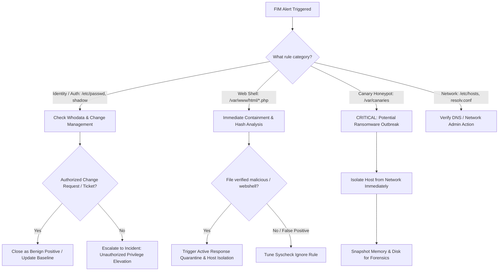

# SOC Analyst Playbook: File Integrity Monitoring (FIM) Triage & Response

## 1. Overview & Objective
This Standard Operating Procedure (SOP) guides Security Operations Center (SOC) Tier 1 and Tier 2 analysts through investigating, triaging, and responding to **File Integrity Monitoring (FIM)** and **Host-based Intrusion Detection System (HIDS)** alerts generated by Wazuh / OSSEC.

---

## 2. Triage Decision Workflow



---

## 3. Step-by-Step Investigation Workflow

### Step 1: Initial Alert Enrichment
When an alert triggers, extract the following core artifacts from the Wazuh JSON event:
- **`syscheck.path`**: Exact full path of the target file.
- **`syscheck.event`**: `file_created`, `file_modified`, or `file_deleted`.
- **`syscheck.sha256_after`** / **`sha256_before`**: File hashes for threat intelligence lookup.
- **`syscheck.diff`**: Exact lines added/deleted via `report_changes="yes"`.
- **`syscheck.audit` (Whodata)**:
  - Process Name (`audit.process.name`)
  - Process ID (`audit.process.id`)
  - Parent Process (`audit.process.parent_name`)
  - User ID / Login UID (`audit.user.id`, `audit.user.name`)

### Step 2: Verification against Change Management (CAB)
1. Check the organization's ticketing system (Jira / ServiceNow / GitLab):
   - Was a scheduled maintenance window active?
   - Was a package upgrade (`apt upgrade`, `yum update`, `Windows Update`) deployed?
   - Did a CI/CD pipeline deploy new application code?
2. If an authorized ticket exists matching the timestamp, user, and modified files:
   - **Classification**: Benign Positive (BP).
   - Document the Change Request ticket number in the alert notes and close.

### Step 3: Determining Malicious Intent (True Positive)
If **NO** authorized ticket exists, treat as a potential compromise:
- **Check the Diff**:
  - Did someone add a user with UID `0` (`/bin/bash`) to `/etc/passwd`? -> **Severe Privilege Escalation**.
  - Did a file in `/var/www/html` contain `eval()`, `system()`, `base64_decode()`, or `shell_exec()`? -> **Web Shell Dropper**.
  - Was an SSH key added to `/root/.ssh/authorized_keys`? -> **Adversary Backdoor Persistence**.
  - Was a binary in `/bin/` or `/usr/bin/` replaced with an unfamiliar hash? -> **Rootkit / Trojan Replacement**.
- **Threat Intelligence Hash Check**:
  - Query VirusTotal, AlienVault OTX, or internal MISP for `syscheck.sha256_after`.

---

## 4. Containment & Remediation Actions

### 1. Automated Active Response
- If Wazuh Active Response is enabled:
  - Verify that `quarantine_file.sh` moved the malicious script to `/var/ossec/quarantine/`.
  - Confirm permissions were stripped (`000`).

### 2. Manual Containment (If Active Response Disabled)
```bash
# 1. Isolate the compromised file
mv /var/www/html/backdoor_shell.php /var/quarantine/backdoor_shell.php.quarantined
chmod 000 /var/quarantine/backdoor_shell.php.quarantined

# 2. Terminate the offending process identified in Whodata
kill -9 <PID>

# 3. Block adversary C2 communication at host firewall
iptables -A INPUT -s <ATTACKER_IP> -j DROP
```

### 3. Canary / Ransomware Containment
If Rule 100015 (Canary tripwire) fires:
1. **Immediately isolate the host from the network** (disconnect vNIC or apply host firewall isolation rule).
2. Kill all non-essential running processes.
3. Preserve RAM image for forensic key extraction if encryption is underway.

---

## 5. Post-Incident Review & Tuning
1. If the alert was a legitimate developer action in a development directory:
   - Add targeted `<ignore>` directive or narrow the monitored scope in `ossec.conf`.
2. If malicious:
   - Review parent process logs to identify root cause / initial access vector.
   - Update threat hunting queries across all endpoints.
